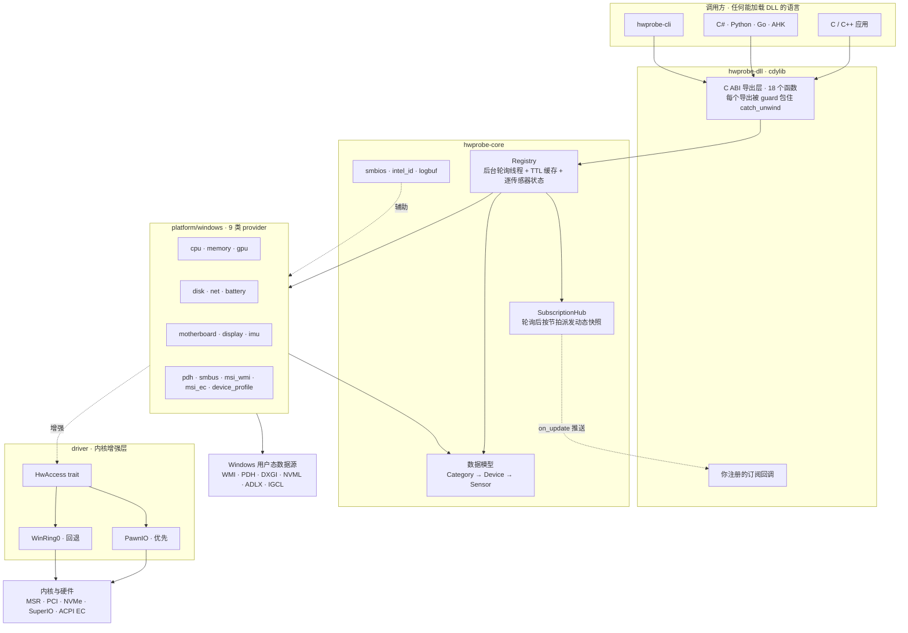
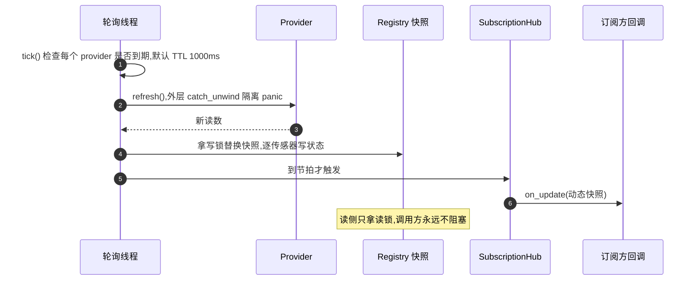

# hwprobe

> 类 HWiNFO 的硬件信息与传感器库,以 C ABI 动态链接库形式提供。
> 一个 `hwprobe.dll`(macOS 上是 `libhwprobe.dylib`),任何语言都能调 —— 免安装,拷走即用。

[](#支持范围)
[-000000?logo=apple&logoColor=white)](#支持范围)
[](https://www.rust-lang.org)
[](#c-api-速览)
[](LICENSE)
[](#开发与测试)

`hwprobe.dll` 提供 **CPU / 内存 / GPU / 硬盘 / 网卡 / 电池 / 主板(含 BIOS) /
显示器 / 惯性传感器(IMU)** 九类硬件的静态识别与实时动态传感器数据。
接口是扁平的 C ABI,C/C++/C#/Python/Rust/Go/AHK 等任何能调动态库的语言都能用。

**设计原则:数据获取可靠优先。** 用户态官方接口为主,内核驱动能力作为可选增强层,
失败时逐传感器优雅降级 —— **绝不给假数据**。

---

## 目录

- [为什么是它](#为什么是它)
- [支持范围](#支持范围)
- [快速开始](#快速开始)
- [构建](#构建)
  - [第三方二进制资源](#第三方二进制资源)
- [命令行工具](#命令行工具)
- [从其他语言调用](#从其他语言调用)
- [C API 速览](#c-api-速览)
- [订阅式流式推送](#订阅式流式推送)
- [内核驱动增强层](#内核驱动增强层)
- [占用口径:标准 vs 类任务管理器](#占用口径标准-vs-类任务管理器)
- [数据源详解](#数据源详解)
- [架构](#架构)
- [可靠性设计](#可靠性设计)
- [已知限制](#已知限制)
- [第三方组件与许可](#第三方组件与许可)

---

## 为什么是它

在 Windows 上取硬件传感器数据,现实是「一堆接口各管一段,还都不太靠谱」:
WMI 慢且会缺字段、NVML 只在 N 卡上、ADLX 只在 A 卡上、Intel 核显又是另一套
IGCL、温度/功耗/风扇必须过内核驱动、SMART 在 Intel RST 虚拟存储栈上只剩 WMI 一条路、
PDH 在装了某些安全软件的机器上直接不可用。

hwprobe 把这些收进一个 DLL 后面:

- **统一的 `(category, device, sensor)` 三元寻址**,不再关心数据来自哪个 API。
- **每个传感器独立携带状态码**。单个数据源故障只影响它自己,不会让整棵树变成空白 ——
  缺驱动就是 `NO_DRIVER`,不支持就是 `NOT_SUPPORTED`,而不是一个骗人的 0。
- **后台单线程轮询 + TTL 缓存**,读操作毫秒级返回,不会因为某一类数据慢而拖住调用方。
- **驱动是可选的**。不装内核驱动,占用率/内存/磁盘/网络照样能用;装了才多出温度/功耗/风扇。
- **HVCI(内存完整性)开着也能用** —— 走微软签名的 PawnIO 沙箱驱动,而不是早就被拉黑的经典驱动。

## 支持范围

| | 状态 |
| --- | --- |
| **Windows 10/11 x64** | 完整实现,本仓库主体 |
| **macOS 12+(Apple Silicon + Intel)** | 完整实现(`platform/macos`),九类全覆盖,全部走用户态公开接口(mach / sysctl / IOKit / AppleSMC / CoreWLAN / CoreGraphics),**无需内核驱动**;逐类差异见「macOS 数据源」 |
| Linux | **接口已稳定,实现是占位骨架**。`platform/linux.rs` 里的 `StubProvider` 对每个类别返回「尚未实现」,`trait` 层不需要改动即可按 Windows 后端的同构模式逐类落地 |

> 说清楚:Linux 后端目前**不可用**。仓库里保留它是因为 `PlatformBackend` / `Provider`
> trait 已经把接口定型,新平台实现只需要填 `probe()` 与 `refresh()`。

## 直接下载

不想自己编译,去 [Releases](https://github.com/xgd16/hwprobe/releases) 拿对应平台的压缩包 —— 每个包都自带动态库、C 头文件、CLI、README 与 LICENSE,解压即用:

| 压缩包 | 平台 | 内容 |
| --- | --- | --- |
| `hwprobe-*-windows-x64.zip` | Windows 10/11 x64 | `hwprobe.dll` + `hwprobe.lib` + `hwprobe-cli.exe` |
| `hwprobe-*-macos-arm64.tar.gz` | macOS 12+,Apple Silicon | `libhwprobe.dylib` + `hwprobe-cli` |
| `hwprobe-*-macos-x64.tar.gz` | macOS 12+,Intel | `libhwprobe.dylib` + `hwprobe-cli` |
| `hwprobe-*-linux-x64.tar.gz` | Linux x86_64 | `libhwprobe.so` + `hwprobe-cli`(骨架后端) |

发布由 GitHub Actions 自动完成:推送 `v*` 标签即触发全平台编译打包,产物附 `SHA256SUMS` 校验文件。

## 快速开始

```bash
# 1. 取第三方二进制资源(仅 Windows 需要,见下文「第三方二进制资源」)
powershell -ExecutionPolicy Bypass -File tool\fetch_assets.ps1

# 2. 构建
cargo build --release

# 3. 看看自己的机器(Windows)
target\release\hwprobe-cli.exe dump
#    macOS/Linux:
target/release/hwprobe-cli dump
```

产物:

| 产物 | 说明 |
| --- | --- |
| `target/release/hwprobe.dll` | 主 DLL,免安装(Windows) |
| `target/release/libhwprobe.dylib` | 主动态库,免安装(macOS) |
| `target/release/hwprobe-cli(.exe)` | 命令行工具 |
| `include/hwprobe.h` | C 头文件,与 ABI 严格对应(两平台同一份) |

`make` 会把动态库和头文件一起整理到 `bin/dll/`(Windows 另含导入库;需要 GNU make + sh):

```bash
make          # == cargo build --release -p hwprobe-dll,产物 → bin/dll/
make debug    # debug 构建
make clean    # 清空 bin/dll
```

## 构建

### 前置要求

| 项 | 要求 |
| --- | --- |
| Rust | edition 2021,MSVC 工具链(`x86_64-pc-windows-msvc`) |
| C 运行库 | MSVC 自带的即可,无需额外安装 |
| GNU make + sh | 仅 `make` 目标需要(Git Bash / MSYS2 提供的 sh 即可) |
| 网络 | 首次构建需要访问 crates.io |

依赖很收敛:核心公共依赖只有 `serde` / `serde_json` / `thiserror`;
Windows 侧是 `windows` crate、`wmi`、`libloading`、`raw-cpuid`,以及本仓库内
vendored 的 `amd-adlx`。**没有任何链接期的厂商 SDK 依赖** ——
NVML、ADLX、IGCL 全部是运行时 `LoadLibrary`,所以没装对应驱动的机器上
`LoadLibrary("hwprobe.dll")` 不会失败。

### 工作区布局

```
crates/
├── hwprobe-core   数据模型 + Provider trait + Registry(轮询/TTL/状态)
│                  + SubscriptionHub + SMBIOS 解析 + Intel 识别表
│                  └── platform/windows   全部 provider 与驱动增强层
│                  └── platform/linux     预留骨架
├── hwprobe-dll    cdylib:C ABI 导出层
├── hwprobe-cli    dump / watch / stream / setup / log 验证工具
└── amd-adlx       AMD ADLX 官方 Rust 绑定(vendored,MIT)
examples/
├── cs-demo        C# P/Invoke 示例(含订阅推送)
├── go-demo        Go purego 动态加载示例(免 cgo,含订阅推送)
└── py-demo        Python ctypes + Tkinter 仪表盘
include/hwprobe.h  C 头文件,ABI 的权威定义
tool/fetch_assets.ps1  拉取并校验第三方二进制资源
```

### 第三方二进制资源

有一份第三方二进制**不随仓库分发**,首次构建前请拉取:

```powershell
powershell -ExecutionPolicy Bypass -File tool\fetch_assets.ps1
```

| 资源 | 用途 | 不拉取的后果 |
| --- | --- | --- |
| `assets/PawnIO_setup.exe`(3.4 MB) | PawnIO 官方签名安装器,`hwprobe_setup_driver()` 与 `hwprobe-cli setup` 用它一键装内核驱动 | 库照常构建;只是驱动级传感器降级为 `NO_DRIVER`,且一键装驱动需要安装器已存在于磁盘 |

脚本会校验 SHA-256、文件大小与 Authenticode 签名(发布者与证书指纹),任何一项不符即中止并删除临时文件。
来源、哈希与许可见 [`assets/PawnIO_setup.README`](crates/hwprobe-core/assets/PawnIO_setup.README)。

**它在构建时被内嵌,但缺失不会导致编译失败。** `build.rs` 会探测该文件:

- **存在** → 设置 `hwprobe_embedded_pawnio_setup`,安装器被 `include_bytes!` 内嵌进
  `hwprobe.dll`(产物体积 +3.4 MB)。发布形态零外部依赖,拷走即用。
- **不存在** → 库照常编译(只有一条 `cargo:warning` 提醒)。此时
  `hwprobe_setup_driver()` 改为在运行期从磁盘上找安装器,依次尝试:
  `HWPROBE_PAWNIO_SETUP` 环境变量 → exe 同目录 → 当前工作目录 →
  `assets/` 与 `crates/hwprobe-core/assets/`。都找不到时返回一条可操作的错误提示。

所以克隆后直接 `cargo build` 永远不会失败;想让产物自带一键装驱动能力,
就先跑 `fetch_assets` 再构建。

已经随仓库分发的小体积第三方内容(都是官方模块字节码 / 驱动本体,许可文件齐全):
`assets/pawnio/*.bin`(PawnIO 模块,LGPL-2.1)、`assets/WinRing0x64.sys`(MPL-2.0)、
`crates/amd-adlx/`(MIT,含 `system_h.txt` 与 ADLX 头文件)。

## 命令行工具

`hwprobe-cli` 与 DLL 共用同一条 core 数据通路,因此它可以作为「DLL 有没有问题」的对照实验。

```
hwprobe-cli [命令] [选项]
```

无参数时等价于 `dump`。**没有 `--help`**,未知命令会打印用法并以退出码 2 结束。

| 命令 | 作用 |
| --- | --- |
| `dump`(默认) | 打印完整的 类别 → 设备 → 传感器 树,含当前值 |
| `watch` | 按间隔持续打印动态传感器的 OK 读值 |
| `stream` | 用**订阅推送**接口收批次(走的是 ABI 2 的回调路径) |
| `setup` | 一键安装 PawnIO 内核驱动(UAC 提权,幂等) |
| `log` | 打印进程内环形日志缓冲(诊断用) |
| `version` | 打印 CLI 版本与 ABI 版本 |

| 选项 | 适用 | 默认 | 说明 |
| --- | --- | --- | --- |
| `--category <名称\|索引>` | dump / watch / stream | 全部 | 名称不区分大小写:`CPU` `Memory` `GPU` `Disk` `Network` `Battery` `Motherboard` `Display` `IMU` |
| `--json` | dump / watch | — | 输出 JSON 而不是文本树 |
| `--wait <毫秒>` | dump / watch | `2000` | 等待各类别取到第二个采样点(差分读数需要两次采样) |
| `--interval <毫秒>` | watch / stream | `1000` | 轮询间隔 / 订阅推送间隔 |
| `--log` | dump / watch | — | 额外把内部诊断日志打印到 **stderr** |
| `--usage-mode <default\|taskmgr>` | 全部 | `default` | 占用率口径,需在初始化前生效 |
| `--count <n>` | stream | 无限 | 收到 n 个批次后退出 |
| `--full` | stream | — | 打印所有项,含非 OK 状态(默认只打印 OK) |

实例:

```bash
hwprobe-cli                                    # 全类别文本树,最多等 2 秒
hwprobe-cli dump --category CPU
hwprobe-cli dump --json --category Memory > mem.json
hwprobe-cli dump --wait 5000 --log             # 诊断日志走 stderr,不污染 stdout
hwprobe-cli watch --interval 500 --category GPU
hwprobe-cli stream --interval 1000 --count 10 --full
hwprobe-cli setup                              # 装驱动(UAC)
```

退出码:`2` = 未知命令 / 未知类别 / 未知口径;`1` = 初始化失败或驱动安装失败。

## 从其他语言调用

### C

```c
#include "hwprobe.h"

hwprobe_init();                       /* 枚举硬件 + 启动后台轮询,幂等 */
uint32_t n;
hwprobe_get_device_count(HWPROBE_CAT_CPU, &n);
for (uint32_t d = 0; d < n; d++) {
    hwprobe_device_info di = { .size = sizeof(di) };
    hwprobe_get_device_info(HWPROBE_CAT_CPU, d, &di);

    uint32_t sn;
    hwprobe_get_sensor_count(HWPROBE_CAT_CPU, d, &sn);
    for (uint32_t s = 0; s < sn; s++) {
        hwprobe_sensor_info si = { .size = sizeof(si) };
        hwprobe_get_sensor_info(HWPROBE_CAT_CPU, d, s, &si);

        hwprobe_reading r = { .size = sizeof(r) };
        hwprobe_read_sensor(HWPROBE_CAT_CPU, d, s, &r);
        /* r.status 决定怎么看 r.value;不要只看值 */
    }
}
hwprobe_shutdown();
```

### C#

`examples/cs-demo` 是完整示例(`dotnet run`)。**union 布局是最容易踩的坑** ——
`hwprobe_value` 是 96 字节的 C union,必须用重叠布局或 `fixed byte[96]` 手工解码:

```csharp
[StructLayout(LayoutKind.Sequential)]
public unsafe struct Reading {
    public uint size, valueType, status;
    public ulong timestampMs;
    public fixed byte value[96];        // union 区,按 valueType 解码
}
```

示例还演示了回调委托必须存在 `static` 字段里防止被 GC 回收。

### Go

`examples/go-demo` 是纯 Go 示例(**免 cgo**),用 [purego](https://github.com/ebitengine/purego)
在运行时动态加载动态库(与 Python ctypes / C# P/Invoke 同一思路),Windows/macOS/Linux 通用:

```bash
cd examples/go-demo
go run .               # 打印设备树 + 订阅推送演示
go run . --all         # 树里包含静态信息传感器(型号/序列号等)
go run . --stream      # 控制台看推送批次
go run . --pull        # 拉取模式:每秒重读,只打印变化值
go run . --json        # 每秒输出 JSON
```

找库顺序与 py-demo 一致(可执行文件目录 → `target/release/` → `target/debug/` →
`bin/dll/` → 系统路径),另可用环境变量 `HWPROBE_LIB` 直接指定路径。
union 同样用 `[96]byte` 接收后按 `value_type` 手工解码;订阅回调用
`purego.NewCallback` 生成函数指针,回调指针存包级变量保活,回调里只做拷贝入队。

### Python

`examples/py-demo/hwprobe_demo.py` 是一个 Tkinter 仪表盘(ctypes 绑定),支持:

```bash
python examples/py-demo/hwprobe_demo.py            # 图形界面
python examples/py-demo/hwprobe_demo.py --json     # 每秒输出 JSON
python examples/py-demo/hwprobe_demo.py --stream   # 控制台看推送批次
python examples/py-demo/hwprobe_demo.py --setup    # 装驱动
python examples/py-demo/hwprobe_demo.py --no-stream   # 强制走轮询模式
```

它自己会按平台找库(Windows `hwprobe.dll` / macOS `libhwprobe.dylib` / Linux
`libhwprobe.so`),依次尝试脚本目录、`target/release/`、`target/debug/` 与系统路径。
C# 示例的 `DllImport("hwprobe")` 同样跨平台:.NET 在 macOS/Linux 自动探测
`libhwprobe.dylib` / `libhwprobe.so`。

## C API 速览

完整定义见 [`include/hwprobe.h`](include/hwprobe.h) —— 那是 ABI 的权威来源。
当前 `HWPROBE_ABI_VERSION == 5`。

### 初始化与全局

```c
uint32_t hwprobe_abi_version(void);                    /* 可在 init 前调用 */
int32_t  hwprobe_init(void);                           /* 幂等;1~2 秒;绝不自动装驱动 */
int32_t  hwprobe_shutdown(void);                       /* 幂等;停机后设备缓存保留 */
int32_t  hwprobe_set_poll_interval(uint32_t ms);       /* 钳制到 100..60000,默认 500 */
int32_t  hwprobe_set_usage_mode(uint32_t mode);        /* 0=标准 / 1=类任务管理器 */
```

### 枚举与读值

```c
int32_t hwprobe_get_category_count(uint32_t *out);
int32_t hwprobe_get_category_info(uint32_t category, hwprobe_category_info *out);
int32_t hwprobe_get_device_count(uint32_t category, uint32_t *out);
int32_t hwprobe_get_device_info(uint32_t category, uint32_t device, hwprobe_device_info *out);
int32_t hwprobe_get_sensor_count(uint32_t category, uint32_t device, uint32_t *out);
int32_t hwprobe_get_sensor_info(uint32_t category, uint32_t device, uint32_t sensor, hwprobe_sensor_info *out);
int32_t hwprobe_read_sensor(uint32_t category, uint32_t device, uint32_t sensor, hwprobe_reading *out);
int32_t hwprobe_refresh(uint32_t category);            /* 显式刷新,通常不需要 */
int32_t hwprobe_dump_json(uint32_t category, char *buf, uint32_t *len);
int32_t hwprobe_last_error(char *buf, uint32_t *len);
```

### 订阅推送

```c
int32_t hwprobe_subscribe(hwprobe_stream_cb callback, void *user_data,
                          uint32_t interval_ms, uint32_t category_mask, uint64_t *out_handle);
int32_t hwprobe_unsubscribe(uint64_t handle);
```

### 驱动

```c
int32_t hwprobe_setup_driver(void);   /* 静默安装 PawnIO(UAC),显式调用,幂等 */
```

### 约定

- 所有导出函数都是 `extern "system"`,可从多线程并发调用。
- **每个结构体的第一个字段是 `size`**,由 DLL 回填 `sizeof(...)`。调用方分配结构体后
  把 `size` 预置成正确值即可(DLL 也会自己写)。
- 字符串一律 UTF-8、NUL 结尾;超长会被截断。
- 两类缓冲区接口(`dump_json` / `last_error`)用两段式协议:先传 `buf = NULL` 拿所需长度,
  再分配调用;缓冲区不够返回 `HWPROBE_BUFFER_TOO_SMALL` 并回填所需长度。

### 状态码

状态码既是每个导出函数的返回值,也是**每个读值自己的 `status` 字段**:

| 值 | 名称 | 含义 |
| --- | --- | --- |
| 0 | `HWPROBE_OK` | 成功 |
| 1 | `HWPROBE_WAITING` | 动态传感器还没等到第一次后台刷新(瞬时状态,稍后再读) |
| 2 | `HWPROBE_NOT_INITIALIZED` | 还没调 `hwprobe_init()` |
| 3 | `HWPROBE_INIT_FAILED` | 初始化失败(详见 `hwprobe_last_error`) |
| 4 | `HWPROBE_INVALID_ARG` | 参数非法(NULL 指针 / mask 为 0 等) |
| 5 / 6 / 7 | `BAD_CATEGORY` / `BAD_DEVICE` / `BAD_SENSOR` | 下标越界 |
| 8 | `HWPROBE_NO_DRIVER` | 该传感器需要内核驱动(温度/风扇/电压),驱动不可用 |
| 9 | `HWPROBE_NOT_SUPPORTED` | 该设备/通道不支持此传感器 |
| 10 | `HWPROBE_ERROR` | 采集失败 |
| 11 | `HWPROBE_BUFFER_TOO_SMALL` | 输出缓冲区不够(`*len` 回填所需大小) |
| 12 | `HWPROBE_UNKNOWN` | 未知错误(FFI 边界捕获到 panic 也是这个) |
| 13 | `HWPROBE_BAD_HANDLE` | 订阅句柄不存在或已取消 |
| 14 | `HWPROBE_NO_PERMISSION` | 权限不足(ABI 5 起;macOS 上 NVMe SMART 等需要 root 的传感器) |

### 类别

| 值 | 类别 | 覆盖 |
| --- | --- | --- |
| 0 | `HWPROBE_CAT_CPU` | 占用(总/逐核)、逐核频率、温度、功耗;混合架构 P/E 核区分 |
| 1 | `HWPROBE_CAT_MEMORY` | 已用/可用/提交、功耗、DIMM 静态信息、内存条温度 |
| 2 | `HWPROBE_CAT_GPU` | 每块 GPU 一个设备:占用(总/分引擎)、温度、功耗、风扇、频率、电压、显存 |
| 3 | `HWPROBE_CAT_DISK` | 每块物理盘:型号/序列号/总线/SSD 判定、温度、磨损、写入量、活动率、吞吐 |
| 4 | `HWPROBE_CAT_NETWORK` | 链路/速率/收发吞吐/错误计数 + WiFi 关联细节(SSID/BSSID/频段/信道/信号/RSSI/协商速率/认证加密/射频开关) |
| 5 | `HWPROBE_CAT_BATTERY` | 电量/电压/充放状态/速率/健康度/循环次数/温度/预计续航(台式机为空清单) |
| 6 | `HWPROBE_CAT_MOTHERBOARD` | BIOS/系统/主板识别 + 板载温度/风扇/电压;掌机另有 EC 第二设备 |
| 7 | `HWPROBE_CAT_DISPLAY` | 分辨率/刷新率/输出技术/触屏(ABI 3 起) |
| 8 | `HWPROBE_CAT_IMU` | 加速度计(g)/ 陀螺仪(°/s)(ABI 3 起) |

`HWPROBE_ALL_CATEGORIES`(`0xFFFFFFFF`)可用于 `hwprobe_refresh` 和订阅掩码。
订阅掩码约定 `bit i = 类别 i`,即 `1u << HWPROBE_CAT_xxx`。

### 值类型

| 值 | 名称 | union 成员 |
| --- | --- | --- |
| 0 | `HWPROBE_VTYPE_F64` | `double f64` |
| 1 | `HWPROBE_VTYPE_U64` | `uint64_t u64` |
| 2 | `HWPROBE_VTYPE_I64` | `int64_t i64` |
| 3 | `HWPROBE_VTYPE_BOOL` | `uint8_t b`(0/1) |
| 4 | `HWPROBE_VTYPE_STR` | `char s[96]`(UTF-8) |

**必须按 `value_type` 取对应成员。** DLL 只写当前类型那一段字节,union 的其余部分是未定义的。

## 订阅式流式推送

不想自己循环拉数据(高频刷新会把负载拉高),就改用订阅推送:注册一次回调,
DLL 在内部轮询线程上按节拍把**全部动态传感器的快照**推给你。

```c
static void on_batch(const hwprobe_stream_batch *b, void *ud) {
    for (uint32_t i = 0; i < b->count; i++) {
        const hwprobe_stream_item *it = &b->items[i];
        /* 只做只读拷贝,立即返回 */
    }
}

hwprobe_init();
uint64_t h;
hwprobe_subscribe(on_batch, NULL, 1000, HWPROBE_ALL_CATEGORIES, &h);
/* 事件循环直接用回调拷出来的数据,无需再轮询 */
hwprobe_unsubscribe(h);
```

- 回调收到 `hwprobe_stream_batch`:`seq`(单调递增批次号,从 1 开始,所有订阅者共享)+
  展平的 `hwprobe_stream_item[]`(category/device/sensor 三元键 + 值 + 状态 + 时间戳)。
  **`items` 指针仅在本次回调期间有效**,回调里拷走即用。
- `interval_ms` 是期望推送间隔:`0` = 跟随后台节拍;非 0 会被钳到 `100..60000`,
  并会把后台节拍下调到不超过它。实际频率还受各数据源 TTL 限制。
  数据没变化时仍会推送(相同值、`seq` 继续递增)。
- 静态传感器**不会**出现在推送里,它们在枚举时读一次就固定。
- **线程契约**:回调在 DLL 内部轮询线程上执行,**必须快速返回**(只做拷贝/入队)。
  不要在回调里调 `hwprobe_refresh` 或 `hwprobe_shutdown`(读 `hwprobe_read_sensor` 是安全的)。
- `hwprobe_unsubscribe` 返回后保证回调不再触发 —— 它会等在途回调跑完;
  **在回调内部退订自身**也是允许的,此时不会自死锁。
- 回调 panic 会被捕获并记录,不影响轮询和其他订阅者。
- **各语言注意**:回调对象必须保持引用(C# 委托存 `static` 字段、Python ctypes 回调存变量),
  否则被 GC 回收后原生回调会崩。

参考 `examples/cs-demo`(委托 + fixed buffer 解码)、`examples/go-demo --stream`(purego.NewCallback + channel)与 `examples/py-demo --stream`(ctypes CFUNCTYPE + 队列)。

## 内核驱动增强层

> 本节仅适用于 **Windows**。macOS 没有内核驱动层概念 —— 全部传感器走用户态公开
> 接口(AppleSMC user client / IOKit / CoreWLAN 等),需要特权的是「root 身份」而非
> 「装驱动」,无权限时按传感器标记 `NO_PERMISSION`。`hwprobe-cli setup` 在 macOS
> 上只打印说明、不做任何事。

CPU 核心温度/封装功耗、主板风扇转速/电压/温度、内存条温度在 Windows 上**必须**经内核驱动读取。
初始化时按顺序尝试两个后端,统一抽象为 `HwAccess` trait(MSR 读写 / IO 端口 / PCI 配置 / AMD SMN):

### 1. PawnIO(优先,推荐)

微软签名的通用沙箱内核驱动,HVCI(内存完整性)开启时**依然可用**。
被 HWiNFO / Fan Control / LibreHardwareMonitor / OpenRGB 采用。

DLL 内嵌官方 Pawn 模块字节码(`IntelMSR` / `AMDFamily17` / `LpcIO` / `LpcACPIEC` /
`SmbusI801` / `SmbusPIIX4` / `SmbusNCT6793`,共 7 个,LGPL-2.1),运行时经设备
`\Device\PawnIO` 加载并按名调用其中的函数,MSR/SMN/SuperIO/SMBus/ACPI EC 访问全部走沙箱白名单。
SMBus 模块按 i801 → PIIX4 → NCT6793 顺序探测,只有 `ioctl_identity` 成功的才被接受。

**一键安装**:

```bash
hwprobe-cli setup          # 或 hwprobe_setup_driver() / Python 示例 --setup
```

会弹出 UAC 后以 `-install -silent` 静默安装官方安装器,装一次即可。
也可以手动装:`winget install namazso.PawnIO`。

> `hwprobe_init()` **绝不会**自动安装内核驱动 —— 静默装驱动必须经用户知情同意,
> UAC 弹窗本身就是那个确认环节。安装成功后需要重启调用进程才会加载驱动,
> 且访问 PawnIO 设备始终需要管理员权限。

### 2. WinRing0(回退)

来自 LibreHardwareMonitor 的经典驱动(MPL-2.0),自动释放到 `%TEMP%\hwprobe\`
并注册服务 `R0hwprobe`(**需要管理员权限**)。在 HVCI 开启或微软易受攻击驱动黑名单下会被拒绝加载。

### 不可用时

两级都不可用(未安装 / 被策略拦截 / 非管理员)时,`access()` 返回 `None`,
依赖驱动层的传感器标记 `NO_DRIVER`,**其余功能完全正常**。

- 设置环境变量 `HWPROBE_NO_DRIVER` 可完全跳过驱动加载(注意:是**存在性**判断,
  设成任何值都生效,不限于 `1`)。
- 卸载清理(管理员):`sc stop R0hwprobe & sc delete R0hwprobe`

### SMBus(内存 SPD / 温度)

内存 SPD 识别与温度读取走 PawnIO 的 SMBus 控制器模块。传输前会按业界惯例持有
`Global\Access_SMBUS.HTP.Method` 互斥体(HWiNFO / AIDA64 / LHM 同样使用),
避免多程序并发操作控制器;拿不到锁时最多等 1 秒后继续,不阻塞轮询线程。

DDR4 走内存条上的 TSOD(可选件,SPD `0x0E` bit7 标志,SMBus 地址 `0x18|槽位`,
寄存器 `0x05`);DDR5 走 SPD5118 hub 自带温度(寄存器 `0x31`)。SPD 读到的
序列号/部件号会与 SMBIOS Type 17 的槽位匹配,**匹配不到就不声明温度传感器** ——
不猜数据。

## 占用口径:标准 vs 类任务管理器

CPU / GPU 占用有两种统计口径,`hwprobe_set_usage_mode` 运行时切换(可在 `init` 前调用)。
传感器清单与编码不变,只切换取值来源。

> **macOS 上两种口径同源**:CPU/GPU 占用只有时间差分 / IOKit 统计一条通路,
> `set_usage_mode` 不改变取值来源(调用合法但无效果),不存在 PDH 依赖。

| | 标准(0,默认) | 类任务管理器(1) |
| --- | --- | --- |
| CPU 总占用 / 逐核 | `GetSystemTimes` / `NtQuerySystemInformation` 差分,纯「忙碌墙钟时间占比」 | PDH `% Processor Utility` ÷ `% Processor Performance` 归一化,封顶 100% |
| GPU 总占用 | 厂商 API(NVML / ADLX / IGCL) | GPU Engine 引擎计数器,各引擎类型分别求和取最忙值 |
| GPU 分引擎占用 | GPU Engine 计数器(两种口径相同) | 同左 |
| 逐核频率 | PDH `Actual Frequency`(实时反映睿频/降频;PDH 不可用则回退 `CallNtPowerInformation` 标称值) | 同左 |
| 参照物 | HWiNFO / AIDA64 等 | Win11 24H2+ 任务管理器默认视图 |

> Win11 24H2 起,任务管理器默认 CPU 视图从原始 `% Processor Utility`(频率加权,
> 睿频时虚高、降频时虚低)改为 Utility÷Performance 归一化口径 —— 数学上等价于
> 时间占比,因此 24H2+ 上两种口径的 CPU 数值基本一致。真正的口径差异在 GPU 侧
> (整卡最忙引擎 vs 厂商 API)。旧系统(Win10 / 23H2 及以前)的任务管理器显示
> 原始 Utility。

### 关于 PDH

部分机器(尤其装了某些安全软件)的性能计数器基础设施会被干扰,导致 PDH
`PdhAddCounter` 系统级失败。因此**默认数据源不依赖 PDH**:
CPU 占用标准口径、磁盘吞吐(`IOCTL_DISK_PERFORMANCE`)、GPU 厂商 API 都是独立的通路。

仍在使用 PDH 的只有两类功能,失败时按传感器逐个标记 `ERROR` 降级:

- **GPU 分引擎占用**(`util_eng_3d` / `util_eng_copy` / `util_eng_video_decode` /
  `util_eng_video_encode` / `util_eng_compute`)—— 数据源就是 GPU Engine 计数器,无等价物;
- **任务管理器口径**下的 CPU 占用与 GPU 总占用聚合,以及两种口径共用的逐核实时频率 ——
  PDH 不可用时频率回退标称值,任务管理器口径占用报 `ERROR`
  (**不静默回退**到标准口径,避免口径混用)。

`pdh.rs` 封装了两个现实坑:

- **通配符必须显式展开**:`PdhAddCounter` 不接受 `(*)`,直接添加返回 `0xC0000BC0`,
  需先经 `PdhExpandCounterPathW` 展开为具体实例再逐个添加;
- **本地化**:统一用 English 计数器路径,不依赖 `_Total` 实例名(本地化系统上不可靠),
  总量聚合在代码内完成。
- GPU Engine 实例随进程动态增减,查询每 10 秒重建以纳入新实例。

## 数据源详解

| 类别 | 静态识别 | 动态值 | 依赖 |
| --- | --- | --- | --- |
| **CPU** | CPUID + WMI(品牌/核数/缓存/插槽);CPUID leaf `0x1A` 区分 P/E 核;Intel 代际识别(签名 → 平台代号/微架构/代际/制程);NPU 经 WMI PnP 枚举 `AI Boost` | 总占用与逐核占用(差分)、逐核实时频率(PDH Actual Frequency)、功耗墙 RAPL `PKG_POWER_LIMIT`(0x610)读 PL1/PL2 | 用户态(+驱动取温度/功耗) |
| **CPU 增强** | — | Intel 逐核/封装温度(DTS `0x19C`/`0x1A2`/`0x1B1`)、RAPL 功耗(`0x606`/`0x611`)、AMD Tctl(SMN `0x59800`)与 `MSRC001_029B` | PawnIO / WinRing0 |
| **内存** | SMBIOS Type 17(槽位/厂商/序列号/部件号/频率/rank/类型) | 已用/可用/提交(`GlobalMemoryStatusEx`)、内存功耗(RAPL DRAM 域 MSR `0x619`)、DIMM 温度(DDR4 TSOD / DDR5 SPD5118) | 用户态(+驱动取功耗/温度) |
| **GPU** | DXGI + WMI(型号/驱动/显存);Intel GPU 识别(PCI Device ID → 平台代号/IP 架构/系列/EU 数) | NVIDIA:温度/功耗/风扇/频率/利用率/显存(**NVML**);AMD:温度/热点/功耗/风扇/频率/电压/显存(**ADLX**);Intel:温度/电压/频率/能耗/活跃度(**IGCL**);通用:显存(DXGI)、分引擎占用 3D/Copy/VideoDecode/VideoEncode/Compute(GPU Engine 计数器) | 用户态(厂商 DLL 运行时加载) |
| **硬盘** | WMI `Win32_DiskDrive`(Index/型号/序列号/PNPID)+ `IOCTL_STORAGE_QUERY_PROPERTY`(总线类型/寻道惩罚/SSD 判定) | NVMe 健康日志(温度/磨损/写入量/备件);SATA SMART 温度(WMI `MSStorageDriver_FailurePredictData` 属性 194/190,或 ATA PASS-THROUGH 读属性区);活动率/吞吐(`IOCTL_DISK_PERFORMANCE` 差分) | 用户态(SMART 需管理员) |
| **网卡** | `GetIfTable2`(MAC/MTU/接口类型/连接名)+ WMI(驱动提供者/版本/INF) | 链路状态/速率、收发吞吐(差分)、收发包与错误计数(`GetIfTable2`);WiFi 经 WLAN API 取关联细节 | 用户态 |
| **电池** | 电池类 IOCTL(`batclass`):设备名/厂商/序列号/唯一 ID/化学类型/生产日期/设计容量/满充容量/告警阈值 | 状态(含 Critical)、电压、剩余容量、充放速率、电量百分比、温度、预计续航/充满时间 | 用户态 |
| **主板** | SMBIOS Type 0/1/2(BIOS/系统/主板) | 风扇转速、电压、板载温度(ITE SuperIO);掌机另有 EC 传感器设备 | PawnIO / WinRing0 |
| **显示器** | DisplayConfig 查活动路径(分辨率/刷新率/输出技术);Raw Input 枚举触屏数字化器 | — | 用户态 |
| **IMU** | Windows Sensor API(COM)枚举传感器 | 加速度计(g)、陀螺仪(°/s) | 用户态 |

### 关于硬盘 SMART 的现实

SATA SMART 温度有两条路径,**都需要管理员**:

- **WMI** `MSStorageDriver_FailurePredictData` —— 在 Intel RST 等虚拟存储栈上是**唯一**可用通路
  (非管理员查询返回空,属正常现象);
- **ATA PASS-THROUGH(12)** —— 标准 AHCI 栈可用,RST 会以
  `ERROR_INVALID_FUNCTION` / `ERROR_REVISION_MISMATCH` 拒绝。

库会依次尝试,失败则该盘没有温度。NVMe 走协议专属 IOCTL,与文件系统栈无关。

### 关于 MSI 掌机

`device_profile` 按 SMBIOS 识别整机形态(系统制造商 + 产品名 + 主板型号),
目前重点覆盖 MSI Claw 系列(A1M = `MS-1T41`,7 AI+ A2VM = `MS-1T42`,8 AI+ A2VM = `MS-1T52`),
并识别其他掌机形态(ROG Ally / Legion Go / Steam Deck / GPD / AYANEO / OneXPlayer)。

MSI 机器有两条独立的通路:

- **`msi_wmi.rs`**:经 `root\WMI` 类 `MSI_ACPI` 调 `GET_FAN`(4 通道风扇,RPM = 480000 / 值)
  与 `GET_EC` —— 走标准 WMI ExecMethod,**用户态即可,无需内核驱动**;
- **`msi_ec.rs`**:经 ACPI EC 直接读寄存器(CPU/GPU 温度 `0x68`/`0x80`、风扇 `0x71`、
  性能模式、电池充电上限、功率限制回读),作为主板类别下的第二设备
  `Embedded Controller (EC)` 暴露。寄存器表采用 MSI Gen-2 EC 约定,
  加载前逐寄存器做范围校验,**校验不过不下发传感器,refresh 时越界标记 Error 而非输出垃圾值**。

### 刷新周期与慢源节流

每个类别有自己的 TTL,轮询线程按 TTL 决定这一轮要不要真正去取数:

| 类别 | TTL | 类别 | TTL |
| --- | --- | --- | --- |
| CPU | 1000 ms | 主板 | 1500 ms |
| 内存 | 1000 ms | 显示器 | 2000 ms |
| GPU | 1000 ms | 电池 | 2000 ms |
| 硬盘 | 1000 ms | IMU | **200 ms** |
| 网卡 | 1000 ms | | |

慢源另有独立节流,避免为了刷新一个贵接口把整轮拖慢:

- ACPI 热区温度:5 秒;
- 内存条 SMBus 温度:**每 3 轮**(≈3 秒,SMBus 事务是毫秒级且全局串行);
- SATA SMART 温度:**每 16 轮**(拿到温度后就不再每轮去问);
- GPU Engine 计数器查询:**每 10 秒**重建一次以纳入新启动的进程(缺失时每 5 秒重试);
- CPU 的 PDH 逐核查询:构建失败后每 5 秒重试;两次采样间隔超过 10 秒(睡眠/休眠唤醒)
  则本轮只重建差分基线、不产出数值,而不是拿跨睡眠的差值算出假峰值。

### 关于 Intel 代际识别

识别表位于 `intel_id.rs`(平台无关的静态查表),设备 ID 分组对齐 Linux 内核的
`intel-family.h` 与 `drm/intel/pciids.h`,覆盖到最新平台(Meteor Lake / Lunar Lake /
Arrow Lake / Panther Lake / Wildcat Lake / Bartlett Lake / Nova Lake,以及 Arc A/B 系列
独显与数据中心 GPU):

- **CPU**:新增静态字段 `CPUID Signature`、`Codename`、`Microarchitecture`
  (混合架构区分 P/E 核)、`Generation`、`Process Node`;
- **GPU**:新增 `GPU Platform`、`GPU Architecture`、`Graphics Series`、`Execution Units`
  (仅在设备 ID 能唯一对应 EU 配置时给出)。

查表未收录的型号直接省略这些字段,**不输出猜测值**。

### macOS 数据源

macOS 后端(`platform/macos`)九类全覆盖,**全部走用户态公开接口,无内核驱动**。
上文「数据源详解」表格是 Windows 通路;macOS 对应关系:

| 类别 | 静态识别 | 动态值 | 权限 |
| --- | --- | --- | --- |
| **CPU** | `sysctl`(品牌串/核数/P-E 簇划分 `hw.perflevel*`/缓存);NPU 经 IORegistry 的 ANE 服务 | 总/逐核占用(`host_processor_info` tick 差分);封装温度(AppleSMC `Tp*/Te*/Tf*` 热敏键取最大值,合理性过滤 + 良值保持) | 免权限 |
| **内存** | `hw.memsize` | 已用/可用/占用率(`host_statistics64`,任务监视器口径:used = 活跃+内联+压缩) | 免权限 |
| **GPU** | IOKit `IOAccelerator`(`model`/`vendor-id`/驱动版本/`gpu-core-count`) | 利用率 `Device Utilization %`/`Renderer Utilization %`、显存占用(`In use system memory`)、温度(AppleSMC `Tg*`) | 免权限 |
| **硬盘** | `IOBlockStorageDevice` 识别(Device/Protocol Characteristics)+ IOMedia 容量 | 活动率/吞吐(`IOBlockStorageDriver Statistics` 差分,Total Time 为纳秒)、NVMe SMART 温度/磨损/写入量(IOKit SMART user client) | SMART 在旧系统需 root → `NO_PERMISSION` |
| **网卡** | `NET_RT_IFLIST2`(MAC/MTU/接口类型)+ CoreWLAN | 链路/速率/收发吞吐(差分)/错误计数 + WiFi 关联细节(RSSI/信道/协商速率/加密) | 免权限;**SSID/BSSID 需定位权限**(否则该字段缺失) |
| **电池** | `AppleSmartBattery` + `BatteryData`(设计容量/循环次数/序列号) | 电量/电压/充放状态/速率/健康度(IOPowerSources + AppleSmartBattery) | 免权限 |
| **主板** | `IOPlatformExpertDevice`(型号标识 `Mac14,9`/序列号/机型号) | 风扇转速(SMC `FNum`+`F{i}Ac`)、WiFi 模块温度(`TW0P`)、整机功耗(`PSTR`)/DC-In 功率(`PDTR`) | 免权限 |
| **显示器** | CoreGraphics + EDID(型号/厂商/序列/接口) | 分辨率/刷新率(`CGDisplayModeGetRefreshRate`,返回 0 的模式回退 CoreVideo 标称值,再拿不到就标 `NOT_SUPPORTED`) | 免权限 |
| **IMU** | — | **Apple Silicon 无运动传感器**;仅 2004-2010 老 Intel Mac 有 Sudden Motion Sensor(读取协议未实现时如实报错,不挂空壳) | — |

macOS 侧如实省略的项目(**宁缺不假**,无用户态来源或来源不可靠):
- **CPU 逐核实时频率**:Apple Silicon 连标称值 sysctl 都没有,不声明 `freq_core_*`
  (Intel Mac 有 `hw.cpufrequency` 标称值,声明并标注 `(Nominal)`)。
- **CPU 封装功耗 `power_pkg`**:AS 的能耗计数走 IOReport 私有接口(macOS 27 起还需
  私有 entitlement),无用户态来源。整机功耗 `PSTR` 在主板类别可用。
- **逐核温度 `temperature_core_*`**:SMC 键随代际变化且社区映射不完全可靠
  (实测 M2 Pro 上表列 8 个"P 核键"而物理 P 核只有 6 个)。仅当「表内键数 == 物理核数」
  严格成立时才做逐核标注,否则只给 `temperature_pkg`。
- **DIMM 明细/内存条温度**:macOS 不暴露 SMBIOS Type 17,Apple Silicon 全是板载内存。
- **commit charge、GPU 分引擎占用、GPU 功耗/风扇**:无对应数据源。
- **语义不明的 SMC 键一律不用**(如 `TVM*`/`TRD*`/`TPD*`,实测存在但无可靠文档);
  只采用有公开语义且经负载实验验证的键(如 `PSTR`/`PDTR`/`F{i}Ac`)。

键位表与系统接口的调研记录(含来源 URL、本机实测值与实测勘误)存档于
[docs/smc-keys-research.md](docs/smc-keys-research.md) 与
[docs/macos-iokit-research.md](docs/macos-iokit-research.md)。

## 架构

### 分层示意



### 采样与推送时序



### 模块布局

```
hwprobe-core   数据模型(Category → Device → Sensor)+ PlatformBackend/Provider trait
               + Registry(后台轮询线程 + TTL 缓存 + per-sensor 状态)
               + SubscriptionHub(订阅推送:轮询后按节拍派发动态快照)
               + smbios(SMBIOS 解析)+ intel_id(静态识别表)+ logbuf(环形日志)
               ├── platform/windows   全部 provider 与驱动增强层
               │     ├── cpu / memory / gpu (+ nvml / adlx / igcl) / disk / net / wlan
               │     ├── battery / motherboard / display / imu / device_profile
               │     ├── msi_wmi / msi_ec / pdh / smbus
               │     └── driver/   HwAccess trait + PawnIO / WinRing0 后端 + SuperIO + ACPI EC
               └── platform/linux     预留骨架
hwprobe-dll    cdylib:C ABI 导出层(结构体布局见 hwprobe.h,guard 包裹 catch_unwind)
hwprobe-cli    dump / watch / stream / setup / log / version 验证工具
crates/amd-adlx  AMD ADLX 官方 Rust 绑定(vendored,MIT)
```

### Registry 的工作方式

- 每个 provider 一个 `RwLock`;**只有一个后台轮询线程写**,读操作只拿读锁。
- 轮询线程每轮 `tick()` 检查每个 provider 是否到 TTL(默认 1000ms),到期才真正刷新。
- 前两次刷新不受 TTL 约束(由一次 tick 节拍把门)—— 这正是差分读数
  (磁盘/网络吞吐、CPU/GPU 占用)不必等满一个 TTL 就能出值的原因。
- 线程用**小步睡眠**(`min(tick, 200ms)`)并每轮重读间隔,所以 `set_poll_interval`
  与 `shutdown` 在 200ms 内生效。
- `probe()` 只在初始化时调用一次。某个类别的 `probe()` 返回 `Err` 只影响它自己:
  记一条 warn、该类设备清单为空,其他类别照常。
- 初始化跑在专用的 `hwprobe-init` 线程上(WMI 需要 MTA),且该线程**常驻不退出** ——
  否则它创建的 COM MTA 与 DXGI 对象会随线程一起被销毁。
- `APP` 是 `OnceLock`,**没有引用计数**:`init` 幂等,`shutdown` 不销毁 Registry,
  所以停机后再 `init` 不必重新 probe。并发 `init` 由一把 `INIT_LOCK` 串行化 ——
  否则败者会多起一个永久泄漏的轮询线程。

## 可靠性设计

- **单个 provider 失败只影响自身类别**:probe 与 refresh 都做隔离,refresh 外面套
  `catch_unwind`,provider panic 时保留旧数据并记一条 error。
- **每个传感器独立状态**:`OK / WAITING / NO_DRIVER / NOT_SUPPORTED / ERROR` 逐项区分,
  单个数据源故障不影响其他字段。**没有等价物就是没有,不填 0**。
- **降级链**:GPU `NVML → ADLX → IGCL → DXGI → WMI`;驱动 `PawnIO → WinRing0 → 无`;
  磁盘 `NVMe IOCTL → SMART(WMI) → ATA 透传 → 不支持`;电池 `IOCTL → WMI`。
- **慢源节流**:WMI 只低频使用,`root\WMI` 的 SMART 查询在拿到温度后每 16 轮才复查一次。
- **FFI 边界不 panic**:每个导出都被 `guard()` 包住,捕获的 panic 映射为
  `HWPROBE_UNKNOWN` 并写入日志;订阅回调另有两层 `catch_unwind`。
- **COM 生命周期统一管理**:WMI / DXGI 的初始化与对象生命周期由常驻初始化线程管理,
  规避 STA 宿主线程与 MTA 随线程退出被销毁两类经典崩溃。
- **互斥体容错**:`stream.rs` 与 DLL 层在锁中毒时用 `into_inner()` 继续,
  因为数据本身仍然一致。
- **环形日志**:512 条进程内日志缓冲,`hwprobe_last_error` 取最近一条 error,
  `hwprobe-cli log` 取全部。
- **不碰系统状态**:`hwprobe_init` 不装驱动、不写注册表;ACPI EC 层**刻意只实现读侧**
  (写 EC 控制寄存器属于系统策略行为,超出监测库职责)。

## 已知限制

**通用**

- **仅 Windows(x64)与 macOS 12+**。Linux 后端是接口完备的骨架,尚无实现。
- **`hwprobe_set_usage_mode` 之后需要等一次刷新**(≤1 秒)才反映到读数上。
- **Intel 代际/GPU 识别表是静态查表**:未收录的型号省略相关字段而不是猜。
- 首次 `hwprobe_init()` 需要 1~2 秒(枚举 WMI/SMBIOS/DXGI 或 IOKit)。
- `hwprobe_dump_json` 的缓冲区由调用方提供,两段式协议用错了会拿到
  `HWPROBE_BUFFER_TOO_SMALL`。

**Windows**

- **温度、功耗、风扇、电压、内存条温度需要管理员权限 + 内核驱动**。
  不装驱动时这些传感器是 `NO_DRIVER`,其余功能不受影响。
- **`hwprobe_setup_driver()` 与 `hwprobe-cli setup` 需要 PawnIO 安装器**:
  构建时若 `assets/PawnIO_setup.exe` 存在会被内嵌,否则运行期从磁盘寻找
  (可用 `HWPROBE_PAWNIO_SETUP` 环境变量指定)。两者都没有时该功能不可用,
  但**编译不受影响**。
- **`HWPROBE_NO_DRIVER` 是存在性判断**:设成任何值(包括 `0`)都会跳过驱动加载。

**macOS**

- **无内核驱动层,但个别传感器需要 root**:NVMe SMART 在旧系统/部分驱动上
  需要 root(本机 macOS 27 实测普通用户可读),无权限时标 `NO_PERMISSION`。
- **WiFi 的 SSID/BSSID 需要定位权限**:无权限时 CoreWLAN 返回 nil,
  这两个字段缺失;RSSI/信道/速率等不受影响。
- **无 CPU 逐核实时频率与封装功耗**(AS 无用户态来源);逐核温度仅在
  温度键数量与物理核数严格一致时才标注(详见「macOS 数据源」)。
- **Boot ROM 版本无用户态来源**(系统报告走私有 SPI),主板类别省略 BIOS 字段。
- **IMU 仅老 Intel Mac 有硬件**,且 Sudden Motion Sensor 读取协议未实现。

## 第三方组件与许可

本项目以 **MIT** 许可发布,见 [LICENSE](LICENSE)。

| 组件 | 位置 | 许可 |
| --- | --- | --- |
| PawnIO 模块(`IntelMSR` / `AMDFamily17` / `LpcIO` / `LpcACPIEC` / `Smbus*`) | `crates/hwprobe-core/assets/pawnio/` | LGPL-2.1(见同目录 `COPYING`) |
| PawnIO 安装器 | 由 `tool/fetch_assets.ps1` 拉取 | 官方未修改二进制;驱动本体 GPL-2.0,**附例外**:经设备 IOCTL 通信的独立软件不受感染 |
| WinRing0x64 | `crates/hwprobe-core/assets/WinRing0x64.sys` | MPL-2.0(来自 LibreHardwareMonitor) |
| `amd-adlx` Rust 绑定 | `crates/amd-adlx/` | MIT(见其中 `LICENSE`,来自 GPUOpen-LibrariesAndSDKs/ADLX) |
| SuperIO / CPU 温度功耗公式 | `driver/superio_impl.rs` | 移植自 LibreHardwareMonitor v0.9.6(MPL-2.0) |

hwprobe 对 PawnIO 驱动的全部访问均为 `DeviceIoControl`,属官方例外条款允许的独立模块;
安装器与模块均以未修改形式分发。

## 开发与测试

```bash
cargo build --release     # 构建全部
cargo test                # 单元测试:SMBIOS 解析 + 各平台纯逻辑(单位换算/解码/回归用例)
make                      # 构建动态库并把产物整理到 bin/dll/
                          # (Windows: hwprobe.dll + hwprobe.lib;macOS: libhwprobe.dylib)
```

测试集中在可离线验证的纯逻辑上,尤其是 SMBIOS 解析器 —— 它有一个专门的回归用例
`zero_string_struct_does_not_desync`:没有字符串结构的 Type 17 在表里是一个裸的双 NUL,
早期实现只跳 1 字节,导致把第二个 NUL 当成下一个结构的类型字节,整段内存条信息错位丢失。
macOS 侧的电池单位换算(mAh×mV/1000、放电率符号约定、温度 0.1K 解码)也有单测锚定。

`crates/hwprobe-core/examples/` 下有一批 `dbg*.rs` 一次性探针,用来单独验证某个数据源
(ADLX 利用率、SuperIO、MSI WMI、SMC 键枚举 `dbg_mac_smc` 等),不属于库的一部分;
Windows 专用探针在其他平台编译为空壳 main,不影响 `cargo test`。

欢迎 Issue 与 PR。改动传感器时请保持两条底线:**宁可缺数据也不给假数据**,
以及**单个数据源故障不拖垮其他类别**。

---

如果这个项目对你有用,欢迎 Star ⭐
